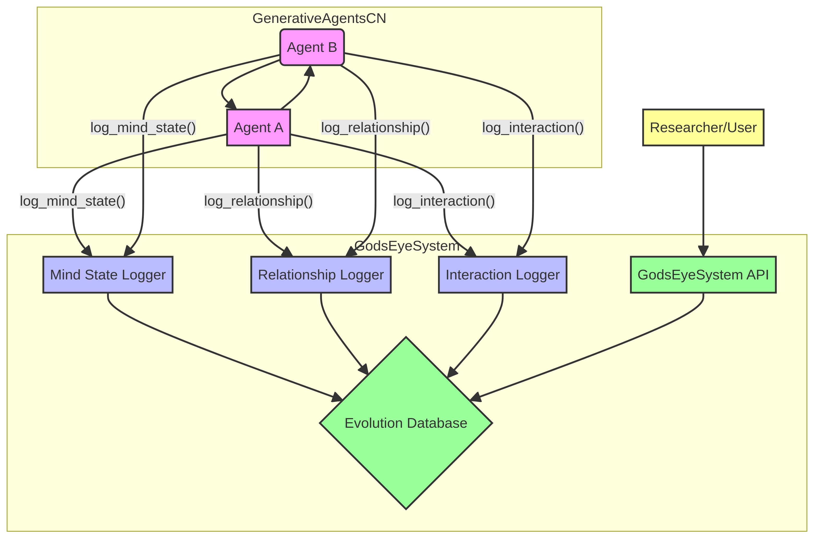

# "上帝视角"观察系统 - 完整文档

**作者**: Manus AI  
**版本**: 1.0  
**日期**: 2026-01-15

---

## 1. 系统概述

"上帝视角"观察系统（God's Eye System）是一个独立的、非侵入式的监控和分析系统，旨在记录和可视化 GenerativeAgentsCN 中所有智能体的心智演化、关系演化和交互过程。它为研究者、开发者和故事创作者提供了一个强大的工具，用于理解和分析智能体社会中的复杂动态。

### 1.1. 核心功能

- **实时监控**：实时记录所有智能体的心智状态、关系和交互。
- **历史追溯**：查询任意时间点的历史数据，回放事件。
- **关系网络**：构建和可视化智能体之间的多维度关系网络。
- **数据分析**：提供丰富的 API，用于分析情绪趋势、关系演化和交互模式。
- **数据导出**：支持将所有数据导出为 JSON 或 CSV 格式，用于外部研究。

### 1.2. 设计原则

- **非侵入式**：不影响智能体的正常行为和决策。
- **高性能**：采用异步写入和批量处理，最小化性能开销。
- **可扩展**：模块化设计，易于添加新的记录器和分析功能。
- **易于使用**：提供简洁的 API，方便查询和分析。

---

## 2. 系统架构

系统主要由四个核心组件构成：记录器（Loggers）、关系管理器（Relationship Manager）、数据库（Evolution Database）和主控系统（God's Eye System）。



### 2.1. 记录器模块 (Loggers)

负责从智能体收集数据并发送给主控系统。

- **`MindStateLogger`**：记录每个智能体在每个时间步的心智状态。
  - **记录内容**：情绪（PAD）、性格（大五人格）、当前活动、位置、记忆统计等。
  
- **`RelationshipLogger`**：记录智能体之间关系的变化。
  - **记录内容**：好感度、信任度、亲密度、印象、血缘关系、社会关系等。
  
- **`InteractionLogger`**：记录智能体之间的所有交互事件。
  - **记录内容**：对话、共同活动、冲突等。
  - **包含丰富上下文**：说话者/听话者的情绪状态、感知偏差、关系变化等。

### 2.2. 关系管理器 (Relationship Manager)

每个智能体拥有一个关系管理器，负责：

- **存储和查询**：与其他智能体的关系数据。
- **动态演化**：根据交互事件更新关系（好感度、信任度等）。
- **关系计算**：提供 API，用于计算关系偏差、获取关系快照等。

### 2.3. 演化数据库 (Evolution Database)

采用 SQLite 作为后端存储，具有以下特点：

- **三个核心表**：`mind_states`, `relationships`, `interactions`。
- **高性能索引**：为所有关键字段创建索引，加速查询。
- **批量写入**：采用内存缓冲区和定时写入，减少 I/O 开销。
- **数据完整性**：使用事务确保数据一致性。

### 2.4. 主控系统 (God's Eye System)

作为全局单例存在，负责：

- **数据接收**：从记录器接收数据，并写入数据库。
- **数据查询**：提供丰富的 API，用于查询时间线、获取统计信息等。
- **数据分析**：提供高级分析功能，如情绪趋势分析、关系演化分析等。
- **数据导出**：支持将数据导出为 JSON 或 CSV。

---

## 3. 核心功能详解

### 3.1. 心智状态记录

在每个 `think()` 循环结束时，智能体会调用 `gods_eye.log_mind_state()`，记录当前的心智快照。

**示例数据**：
```json
{
  "agent": "阿伊莎",
  "timestamp": 1673789400.0,
  "emotion": {"pleasure": 0.6, "arousal": 0.4, "dominance": 0.5},
  "personality": {"openness": 0.85, ...},
  "current_activity": "在茶馆阅读",
  "location": "(10, 15)"
}
```

### 3.2. 关系演化

在每次交互后，智能体会调用 `relationships.update_relationship()`，根据交互的积极性和强度更新关系。

**演化逻辑**：
- **正面交互**：好感度、信任度、亲密度上升。
- **负面交互**：下降（且影响更大）。
- **长期不联系**：亲密度自然衰减。

### 3.3. 交互记录

在 `add_chat()` 方法中，详细记录了每次对话的完整上下文。

**示例数据**：
```json
{
  "interaction_type": "dialogue",
  "speaker": "张伟",
  "listener": "阿伊莎",
  "content": "阿伊莎，今天天气真好！...",
  "speaker_state": {
    "real_emotion": {"pleasure": 0.7, ...}
  },
  "listener_state": {
    "perceived_emotion": {"pleasure": 0.7, ...},
    "my_emotion_before": {"pleasure": 0.6, ...},
    "my_emotion_after": {"pleasure": 0.65, ...}
  }
}
```

---

## 4. API 使用示例

### 4.1. 查询 API

```python
# 获取上帝视角系统实例
gods_eye = get_gods_eye_system()

# 查询阿伊莎的情绪时间线
emotion_timeline = gods_eye.get_agent_emotion_timeline("阿伊莎")

# 查询阿伊莎和张伟的关系演化
relationship_timeline = gods_eye.get_relationship_timeline("阿伊莎", "张伟")

# 查询最近的 10 次交互
recent_interactions = gods_eye.get_recent_interactions(limit=10)
```

### 4.2. 分析 API

```python
# 分析阿伊莎过去一小时的情绪变化
emotion_analysis = gods_eye.analyze_emotion_change("阿伊莎", time_window=3600)

# 分析阿伊莎和张伟的关系演化趋势
relationship_analysis = gods_eye.analyze_relationship_evolution("阿伊莎", "张伟")
```

---

## 5. 研究与应用价值

这个系统为以下领域提供了强大的研究工具：

- **计算社会科学**：研究群体行为、情感传染、网络演化等。
- **认知心理学**：验证认知偏差、情感投射等理论模型。
- **人工智能**：构建更具同理心和社交智能的 AI。
- **游戏开发**：创造更真实、更具沉浸感的 NPC 交互。
- **故事创作**：自动生成角色弧光、发现戏剧性冲突。

---

## 6. 未来展望

- **可视化前端**：开发一个 Web 前端，实时可视化所有数据。
- **导演模式**：允许用户干预智能体的行为和关系。
- **预测分析**：基于历史数据预测未来的情绪和关系变化。
- **多模态支持**：记录和分析语音、表情等多模态信息。

---

**文档结束**
