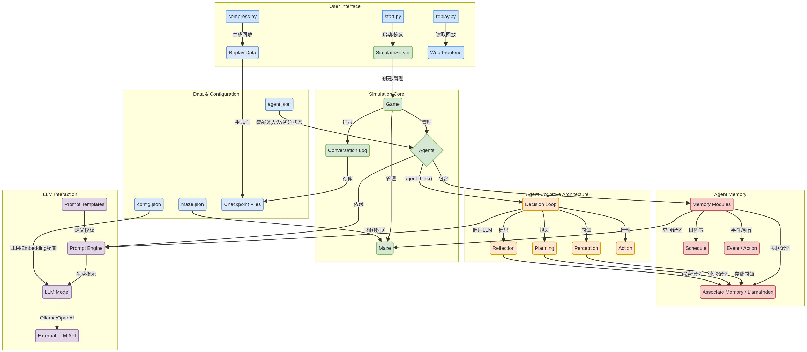

# GenerativeAgentsCN 深度分析与扩展建议报告

**作者**: Manus AI
**日期**: 2026年1月15日

## 1. 项目概述

GenerativeAgentsCN 是对斯坦福大学和谷歌联合开源的“生成式智能体”（Generative Agents）项目的深度汉化和重构版本。原项目通过一个由25个AI智能体组成的虚拟小镇，模拟了复杂的人类社会行为。此中文版项目旨在解决原版代码工程化程度低、难以维护和扩展的问题，并针对中文语言环境和模型（如Qwen、GLM-4）进行了深度优化。

项目基于 [wounderland](https://github.com/Archermmt/wounderland) 的重构代码，具备更优良的结构和代码质量。核心工作包括：

- **提示语汉化与优化**：重写全部提示语，使其“母语”为中文，并针对中文大语言模型（LLM）的特性进行优化。
- **完全本地化部署**：增加了对本地 Ollama API 的支持，实现了语言模型和嵌入模型的完全本地化，降低了实验成本。
- **功能增强**：引入了“断点恢复”等实用功能，并简化了回放界面，将智能体活动记录输出为易于阅读的 Markdown 文件。
- **现代化重构**：使用 `pydantic` 模型替代正则表达式进行输出解析，提升了代码的健壮性和可维护性。

## 2. 架构分析

为了清晰地理解项目结构，我们绘制了以下系统架构图。该图展示了从用户交互、模拟核心到智能体认知结构和底层数据流的完整链路。

项目的整体架构可以分为六个核心部分：

| 模块 | 核心组件 | 主要职责 |
| :--- | :--- | :--- |
| **用户接口 (User Interface)** | `start.py`, `compress.py`, `replay.py` | 提供启动模拟、生成回放数据和启动Web前端进行可视化回放的入口。 |
| **模拟核心 (Simulation Core)** | `SimulateServer`, `Game`, `Agent`, `Maze` | 负责整个模拟世界的创建、管理和时间推进。`Game` 类是核心，管理所有智能体和地图环境。 |
| **智能体认知架构 (Agent Cognitive Architecture)** | `Agent.think()` | 定义了智能体的核心“思考”循环，包括感知（Perception）、规划（Planning）、反思（Reflection）和行动（Action）。 |
| **智能体记忆 (Agent Memory)** | `memory` 模块 (`associate`, `spatial`, `schedule`) | 为智能体提供记忆能力，包括基于向量检索的关联记忆、对环境布局的空间记忆和用于日常规划的日程记忆。 |
| **LLM 交互 (LLM Interaction)** | `llm_model`, `prompt` 模块 | 封装了与大语言模型的交互逻辑，支持通过Ollama或OpenAI兼容API调用外部LLM，并通过模板引擎动态生成提示。 |
| **数据与配置 (Data & Configuration)**| `config.json`, `agent.json`, `maze.json` | 存储了系统的所有配置信息，包括模型设置、智能体“人设”、地图布局和模拟过程中的检查点数据。 |

## 3. 核心模块详解

### 3.1. `start.py` 与 `SimulateServer`

这是项目的入口。`start.py` 负责解析命令行参数（如模拟名称、开始时间、是否恢复等），并初始化 `SimulateServer`。`SimulateServer` 类是模拟的主控制器，其核心职责是：

- **配置管理**：根据是新游戏还是断点恢复，加载或创建 `sim_config`。
- **游戏创建**：实例化 `Game` 对象，这是整个虚拟世界的容器。
- **模拟循环**：调用 `simulate()` 方法，在指定步数内驱动时间流逝。在每个步骤中，它会遍历所有智能体，调用其 `think()` 方法，并保存模拟状态的快照（Checkpoint）。

### 3.2. `modules/game.py`

`Game` 类是虚拟世界的“上帝”，它持有对所有智能体（`Agent`）和地图（`Maze`）的引用。它的主要功能是协调模拟的进行，在 `agent_think()` 方法中，它会调用每个 `Agent` 实例的 `think()` 方法，并记录和输出智能体的状态摘要。

### 3.3. `modules/agent.py`

`Agent` 类是项目的灵魂，定义了每个智能体的内部状态和认知能力。每个 `Agent` 实例都拥有独立的记忆、计划和状态。

- **初始化**：在 `__init__` 中，智能体加载其“人设”配置，并初始化其记忆模块（空间、日程、关联记忆）。
- **核心循环 `think()`**：这是智能体行为的驱动器。在一个 `think` 周期内，智能体会：
    1.  **移动和感知**：更新自身位置并感知周围环境中的事件和其他智能体。
    2.  **制定/执行计划**：根据日程表（`Schedule`）决定当前的宏观任务。
    3.  **反思**：如果满足特定条件（如新的一天开始），会回顾过去的记忆，形成更高层次的见解。
    4.  **行动决策**：根据当前计划和感知到的信息，决定下一步的具体行动（`Action`），例如移动、对话或与对象交互。

### 3.4. `modules/memory` 记忆模块

记忆是智能体行为复杂性的基础。项目将记忆分为几个关键部分：

- **`associate.py` (关联记忆)**：这是最重要的记忆形式，基于 `LlamaIndex` 实现。所有观察到的事件、对话和反思都会被编码成 `Concept` 对象，并存储在向量索引中。当智能体需要回忆相关信息时，会使用一个综合了**新近度（Recency）**、**重要性（Importance）**和**相关性（Relevance）**的自定义检索器（`AssociateRetriever`）来查询这些记忆。
- **`spatial.py` (空间记忆)**：存储了智能体对世界地图的认知，包括不同区域（`sector`）、场景（`arena`）和对象（`game_object`）的位置。这使得智能体能够理解“我在哪里”以及“某物在哪里”。
- **`schedule.py` (日程记忆)**：智能体使用它来制定和遵循日常计划。LLM会首先生成一个粗略的日计划，然后在执行过程中逐步将其分解为更具体的行动步骤。
- **`event.py` (事件)**：这是记忆的基本单位，以 `(主语, 谓语, 宾语)` 的三元组形式表示一个观察或行动。

### 3.5. `modules/prompt` 与 `modules/model`

这部分是智能体“大脑”与LLM的接口。

- **`prompt/scratch.py`**：这是一个强大的提示工程引擎。它将所有与LLM的交互都封装成独立的 `prompt_*` 方法。每个方法都从 `data/prompts` 目录下的文本模板中加载基础提示，然后用当前上下文信息（如智能体状态、记忆、观察等）填充模板，最终生成发送给LLM的完整提示。
- **`model/llm_model.py`**：该模块抽象了与不同LLM后端的通信。它支持 `Ollama` 和 `OpenAI` 兼容的API。值得注意的是，它集成了 `pydantic`，能够让LLM根据定义的模型返回结构化的JSON数据，极大地提高了输出的可靠性，避免了繁琐的正则表达式解析。

## 4. 关键机制分析

### 4.1. 感知-规划-行动循环 (Perception-Planning-Action Loop)

这是智能体行为的核心驱动逻辑，在 `Agent.think()` 方法中实现：

1.  **感知 (Perception)**：智能体通过 `percept()` 方法观察其周围环境。它会扫描视野范围内的 `Tile`，收集其中的事件（`Event`），并将这些事件作为新的记忆存入关联记忆库中。
2.  **规划 (Planning)**：通过 `make_schedule()` 和 `make_plan()`，智能体决定其目标。首先，它会基于长期计划和近期记忆生成或更新当天的日程表（`Schedule`）。然后，根据当前时间和日程，确定当前应该执行的宏观计划（例如“去图书馆学习”）。
3.  **行动 (Action)**：确定宏观计划后，通过 `_determine_action()` 等方法将其分解为具体行动。这可能需要多次调用LLM来决定具体的地点（`determine_sector`）、场景（`determine_arena`）和交互对象（`determine_object`）。最终，这些决策会形成一个具体的 `Action` 对象，指导智能体的移动和交互。

### 4.2. 对话机制

对话在 `_chat_with()` 方法中触发。当两个智能体相遇时，它们会评估是否需要发起对话。评估依据包括：它们之间的关系、上次对话的时间、以及当前情境。如果决定对话，系统会：

1.  从记忆中检索与对方相关的记忆和过去的对话。
2.  构建一个包含双方背景、记忆和当前情境的复杂提示。
3.  进入一个多轮对话循环，交替调用LLM为每个智能体生成回复。
4.  对话结束后，将对话内容和总结存入记忆库。

### 4.3. 回放与数据压缩

`compress.py` 脚本负责将模拟过程中产生的大量检查点（checkpoint）文件进行处理，生成用于回放的数据。

- **`movement.json`**：包含了每个智能体在每个时间步（frame）的位置、朝向和当前动作描述。为了实现平滑的动画效果，它会计算两个检查点之间的路径，并进行插值。
- **`simulation.md`**：一个人类可读的日志文件，按时间线记录了每个智能体在每个时间点的状态、活动以及发生的对话，非常便于分析和调试。

## 5. 扩展建议

基于对项目代码的深入分析，我们提出以下几个可行的扩展方向：

### 5.1. 丰富智能体的行动能力

- **引入工具使用 (Tool Use)**：可以为智能体增加使用“工具”的能力。例如，允许智能体通过“计算机”对象访问简化的搜索引擎API来获取外部信息，或者使用“电话”给其他智能体发送消息。这将需要扩展 `Action` 类型，并为工具使用设计新的提示词模板。
- **更复杂的对象交互**：目前对象交互比较简单（例如“坐在沙发上”）。可以设计更复杂的交互逻辑，例如，一个智能体打开电视，会影响到同一房间内其他智能体的状态和行为。

### 5.2. 增强记忆与反思机制

- **分层记忆系统**：可以借鉴认知心理学的模型，设计一个更复杂的分层记忆系统，例如区分短期工作记忆和长期情景记忆。这可以优化检索效率，并使智能体的行为更符合人类认知模式。
- **主动反思与元认知**：当前的反思是被动触发的。可以设计一种机制，让智能体在遇到新奇或冲突的事件时主动进行反思，甚至对自己的思考过程进行反思（元认知），从而调整其未来的行为策略。

### 5.3. 动态世界与外部事件

- **引入全局事件系统**：可以创建一个全局事件管理器，在模拟过程中注入外部事件，如“天气变化”、“节日活动”或“突发新闻”。所有智能体都能感知到这些全局事件，并作出相应的反应，这将大大增加模拟的涌现复杂性。
- **用户交互接口**：可以创建一个接口，允许用户在模拟运行时直接与某个智能体对话，或者作为“上帝”向世界中添加或修改对象，观察智能体如何适应这些变化。

### 5.4. 性能与可扩展性优化

- **异步LLM调用**：当前LLM调用是同步阻塞的，当智能体数量增多时，这会成为性能瓶颈。可以将LLM调用改为异步方式，允许在一个智能体等待LLM响应时，继续处理其他智能体的逻辑。
- **批量化LLM请求**：在某些场景下（如多个智能体同时进行相似的思考），可以将多个请求合并为一个批量请求发送给LLM，以提高吞吐量。
- **分布式模拟**：对于超大规模的模拟，可以探索将不同的智能体或地图区域分布到不同的计算节点上运行，通过消息队列进行状态同步。

## 6. 总结

GenerativeAgentsCN 是一个结构清晰、高度可扩展的生成式智能体研究框架。它通过巧妙的模块化设计，将复杂的认知架构分解为记忆、规划、行动等多个协同工作的组件。其深度汉化和对本地模型的支持，为中文社区的研究者和开发者提供了一个极佳的起点。通过本文提出的扩展建议，可以在此基础上探索更广阔的智能体行为和社会模拟研究领域。

---

### 参考资料

[1] Generative Agents: Interactive Simulacra of Human Behavior. [https://arxiv.org/abs/2304.03442](https://arxiv.org/abs/2304.03442)
[2] GenerativeAgentsCN GitHub Repository. [https://github.com/sxhfut/GenerativeAgentsCN](https://github.com/sxhfut/GenerativeAgentsCN)
[3] wounderland GitHub Repository. [https://github.com/Archermmt/wounderland](https://github.com/Archermmt/wounderland)
