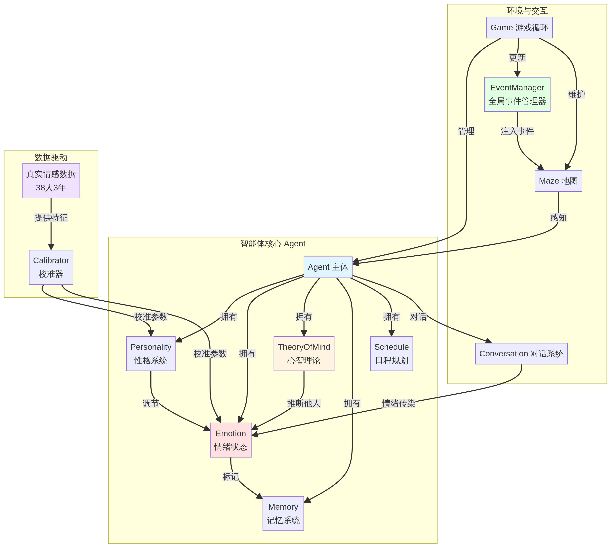

# GenerativeAgentsCN 心智增强扩展技术实施方案

## 1. 概述

本文档旨在为 **GenerativeAgentsCN** 项目提供一个详细的技术实施方案，以集成情绪、心智理论、全局事件系统，并利用真实情感数据进行模型校准。方案基于对您提出的改进思路与项目现有架构的深度对比分析，旨在提供一条清晰、分阶段、低风险的开发路径。

## 2. 最终架构设计

扩展后的系统架构如下图所示。核心思想是在现有 `Agent` 和 `Game` 循环的基础上，无缝集成 `Emotion`（情绪）、`Personality`（性格）、`TheoryOfMind`（心智理论）和 `EventManager`（全局事件管理器）四大模块。



## 3. 分阶段实施路线图

我们建议采用四阶段渐进式开发，确保每个阶段都有可验证的成果。

- **第一阶段：情绪系统基础**
  - **目标**：让智能体拥有内在的情绪状态，并能通过行为和语言表达。
  - **核心产出**：一个可以运行的、智能体情绪会随事件波动的小镇版本。

- **第二阶段：真实数据校准**
  - **目标**：利用您提供的38人三年情感数据，使智能体的情绪模式逼近真实人类。
  - **核心产出**：一个经过数据校准的、情绪反应更真实的情感模型和性格系统。

- **第三阶段：心智理论与事件系统**
  - **目标**：赋予智能体理解他人心理状态的能力，并引入外部环境挑战。
  - **核心产出**：智能体能够进行更复杂的社交互动（如安慰、怀疑），并能响应全局灾难事件。

- **第四阶段：复杂社会现象研究**
  - **目标**：利用构建好的“计算社会学实验室”，开展假设驱动的科学研究。
  - **核心产出**：关于情绪传染、社会支持、群体行为等现象的模拟实验报告和洞见。

## 4. 模块化实施细节

以下是每个新模块或需修改模块的具体代码实现和集成指南。

### 4.1. [第一阶段] 核心心智模块：`Personality` & `Emotion`

**目标**：建立智能体内部的性格和情绪模型。

#### 4.1.1. `Personality` 模块

- **文件**：`generative_agents/modules/personality.py` (新建)
- **说明**：定义智能体稳定的人格特质，这些特质将调节情绪反应的强度和风格。

```python
# generative_agents/modules/personality.py

import json

class Personality:
    """定义智能体的性格特质（基于大五人格模型）"""
    def __init__(self, openness, conscientiousness, extraversion, agreeableness, neuroticism):
        self.openness = self._clip(openness)                 # 开放性：想象力、创造力
        self.conscientiousness = self._clip(conscientiousness) # 尽责性：条理性、自律
        self.extraversion = self._clip(extraversion)           # 外向性：社交性、热情
        self.agreeableness = self._clip(agreeableness)         # 宜人性：合作性、同理心
        self.neuroticism = self._clip(neuroticism)             # 神经质：情绪不稳定性

    def _clip(self, value):
        return max(0.0, min(1.0, value))

    @classmethod
    def from_config(cls, agent_config):
        personality_config = agent_config.get("personality", {})
        return cls(
            openness=personality_config.get("openness", 0.5),
            conscientiousness=personality_config.get("conscientiousness", 0.5),
            extraversion=personality_config.get("extraversion", 0.5),
            agreeableness=personality_config.get("agreeableness", 0.5),
            neuroticism=personality_config.get("neuroticism", 0.5),
        )
```

#### 4.1.2. `Emotion` 模块

- **文件**：`generative_agents/modules/emotion.py` (新建)
- **说明**：定义和管理智能体动态的情绪状态，基于PAD三维模型。

```python
# generative_agents/modules/emotion.py

class EmotionState:
    """基于PAD三维模型的情绪状态"""
    def __init__(self, pleasure=0.0, arousal=0.0, dominance=0.0):
        self.pleasure = pleasure    # 愉悦度 [-1, 1]
        self.arousal = arousal      # 唤醒度 [0, 1]
        self.dominance = dominance  # 支配感 [-1, 1]

    def _clip(self):
        self.pleasure = max(-1.0, min(1.0, self.pleasure))
        self.arousal = max(0.0, min(1.0, self.arousal))
        self.dominance = max(-1.0, min(1.0, self.dominance))

    def update_from_event(self, event, personality):
        # 简化的事件影响模型：具体影响值需通过LLM或规则定义
        # 示例：正面事件增加pleasure，负面事件减少pleasure
        # 强度与 personality.neuroticism 相关
        event_impact = self._calculate_event_impact(event, personality)
        self.pleasure += event_impact.get('pleasure', 0.0)
        self.arousal += event_impact.get('arousal', 0.0)
        self.dominance += event_impact.get('dominance', 0.0)
        self._clip()

    def update_from_contagion(self, other_emotion, personality, closeness):
        # 情绪传染：强度与对方唤醒度、自身宜人性、关系亲密度相关
        contagion_strength = other_emotion.arousal * personality.agreeableness * closeness
        self.pleasure += (other_emotion.pleasure - self.pleasure) * contagion_strength * 0.1 # 学习率
        self.arousal += (other_emotion.arousal - self.arousal) * contagion_strength * 0.1
        self._clip()

    def decay(self, personality):
        # 情绪衰减：向基线回归，速度与 personality.neuroticism (神经质) 相反
        decay_rate = (1 - personality.neuroticism) * 0.05
        self.pleasure -= self.pleasure * decay_rate
        self.arousal -= self.arousal * decay_rate
        self.dominance -= self.dominance * decay_rate
        self._clip()

    def _calculate_event_impact(self, event, personality):
        # TODO: 此处应调用LLM或规则库，根据事件描述和性格，判断情绪影响
        # 伪代码
        if "happy" in event.describe or "good" in event.describe:
            return {'pleasure': 0.2 * (1 + personality.neuroticism)}
        if "sad" in event.describe or "bad" in event.describe:
            return {'pleasure': -0.2 * (1 + personality.neuroticism)}
        return {}

    def to_dict(self):
        return {
            "pleasure": self.pleasure,
            "arousal": self.arousal,
            "dominance": self.dominance
        }
```

#### 4.1.3. 集成到 `Agent`

- **文件**：`generative_agents/modules/agent.py` (修改)

```python
# generative_agents/modules/agent.py

# 在文件顶部添加 import
from generative_agents.modules.personality import Personality
from generative_agents.modules.emotion import EmotionState

class Agent:
    def __init__(self, config, maze, conversation, logger):
        # ...
        # 原有代码
        # ...

        # 新增：初始化性格和情绪模块
        self.personality = Personality.from_config(config)
        self.emotion = EmotionState()

    def think(self, status, agents):
        # ...
        # 原有代码
        # ...

        # 新增：在每个思考循环中更新情绪
        # 1. 感知事件并更新情绪
        observed_events = self.percept()
        for event in observed_events:
            self.emotion.update_from_event(event, self.personality)
        
        # 2. 情绪自然衰减
        self.emotion.decay(self.personality)

        # ...
        # 原有代码
        # ...
```

#### 4.1.4. 修改 `agent.json` 配置

在 `generative_agents/frontend/static/assets/village/agents/` 目录下的每个智能体配置文件中，增加 `personality` 字段。

```json
{
  "name": "阿伊莎",
  "age": 23,
  "gender": "女",
  "scratch": {
    ...
  },
  "personality": {
    "openness": 0.7,
    "conscientiousness": 0.6,
    "extraversion": 0.8,
    "agreeableness": 0.75,
    "neuroticism": 0.3
  }
}
```

### 4.2. [第二阶段] 真实数据校准模块

**目标**：创建一个校准器，用真实数据调整模型的参数。

- **文件**：`generative_agents/calibrator.py` (新建)
- **说明**：这是一个离线工具，用于在模拟开始前，寻找能最好拟合真实数据统计特征的模型参数。

```python
# generative_agents/calibrator.py

import numpy as np
import pandas as pd
from scipy.optimize import minimize

# 假设 Game 和 Agent 类可以被导入并用于模拟
# from generative_agents.modules.game import Game

class EmotionCalibrator:
    def __init__(self, real_data_path):
        self.real_data = pd.read_csv(real_data_path) # 假设是CSV格式
        self.target_stats = self._compute_statistics(self.real_data)

    def _compute_statistics(self, df):
        # 计算真实数据的关键统计特征
        stats = {
            'mean_pleasure': df['pleasure'].mean(),
            'std_pleasure': df['pleasure'].std(),
            # ...可以增加更多统计量，如自相关性、周末效应等
        }
        return stats

    def _run_simulation(self, params):
        # 此函数需要能够启动一个简化版的模拟
        # params 包含要优化的参数，如情绪衰减率、事件影响强度等
        print(f"Running simulation with params: {params}")
        # ... 运行模拟 ...
        # ... 收集模拟产生的情绪数据 ...
        # simulated_df = ...
        # return simulated_df
        # 伪代码：返回一个模拟的DataFrame
        simulated_data = {'pleasure': np.random.normal(params[0], params[1], size=1000)}
        return pd.DataFrame(simulated_data)

    def objective_function(self, params):
        # 目标函数：最小化模拟数据与真实数据统计特征的差异
        simulated_df = self._run_simulation(params)
        simulated_stats = self._compute_statistics(simulated_df)
        
        error = (
            (simulated_stats['mean_pleasure'] - self.target_stats['mean_pleasure'])**2 +
            (simulated_stats['std_pleasure'] - self.target_stats['std_pleasure'])**2
        )
        print(f"Error: {error}")
        return error

    def calibrate(self):
        initial_params = [0.0, 0.5] # 初始猜测的 pleasure 均值和标准差
        result = minimize(
            self.objective_function, 
            initial_params, 
            method='Nelder-Mead'
        )
        
        if result.success:
            return result.x
        else:
            raise Exception("Calibration failed!")

# 使用示例
# if __name__ == "__main__":
#     calibrator = EmotionCalibrator('path/to/your/real_emotion_data.csv')
#     optimal_params = calibrator.calibrate()
#     print(f"Optimal parameters found: {optimal_params}")
```

### 4.3. [第三阶段] `TheoryOfMind` & `EventManager`

#### 4.3.1. `TheoryOfMind` 模块

- **文件**：`generative_agents/modules/theory_of_mind.py` (新建)
- **说明**：建模智能体对他人心理状态的推断。

```python
# generative_agents/modules/theory_of_mind.py

class OtherAgentModel:
    """对另一个智能体的心理模型"""
    def __init__(self, name):
        self.name = name
        self.believed_emotion = None      # 我认为他的情绪 (EmotionState)
        self.believed_intention = ""      # 我认为他的意图 (str)
        self.trust_level = 0.5            # 对他的信任度 [0, 1]
        self.last_update = 0

class TheoryOfMind:
    def __init__(self, agent):
        self.agent = agent
        self.other_models = {}  # {agent_name: OtherAgentModel}

    def get_model(self, other_agent_name):
        if other_agent_name not in self.other_models:
            self.other_models[other_agent_name] = OtherAgentModel(other_agent_name)
        return self.other_models[other_agent_name]

    def infer_state(self, other_agent, observed_event):
        """在观察到对方行为后，推断其心理状态"""
        model = self.get_model(other_agent.name)
        
        # 调用LLM进行推理 (需要新的prompt模板)
        # prompt = f"...基于你对{other_agent.name}的了解，他刚刚做了'{observed_event.describe}'，
        # 你认为他现在的心情如何？他的意图可能是什么？..."
        # response = self.agent.completion(prompt, ...)
        
        # 伪代码：解析LLM的响应并更新模型
        # inferred_emotion, inferred_intention = parse_llm_response(response)
        # model.believed_emotion = inferred_emotion
        # model.believed_intention = inferred_intention
        # model.last_update = self.agent.maze.get_time()
        pass
```

- **集成**：在 `Agent.__init__` 中初始化 `self.theory_of_mind = TheoryOfMind(self)`，并在 `Agent.think()` 循环中，当观察到其他智能体的重要事件时，调用 `self.theory_of_mind.infer_state()`。

#### 4.3.2. `EventManager` 模块

- **文件**：`generative_agents/modules/event_manager.py` (新建)
- **说明**：管理和注入独立于智能体行为的全局事件。

```python
# generative_agents/modules/event_manager.py

class GlobalEvent:
    def __init__(self, description, trigger_time, duration, affected_area):
        self.description = description
        self.trigger_time = trigger_time
        self.duration = duration
        self.affected_area = affected_area # e.g., a list of tile coordinates
        self.is_active = False

class EventManager:
    def __init__(self):
        self.global_events = []

    def register_event(self, event: GlobalEvent):
        self.global_events.append(event)

    def update(self, current_time, maze):
        """在每个时间步更新事件状态，并将其注入到环境中"""
        for event in self.global_events:
            if not event.is_active and current_time >= event.trigger_time:
                event.is_active = True
                # 将事件效果应用到地图上
                for coord in event.affected_area:
                    maze.get_tile(coord[0], coord[1]).add_event(
                        # 创建一个特殊的全局事件三元组
                        ("Environment", "is", event.description)
                    )
            # 可以在这里添加事件结束的逻辑
```

- **集成**：在 `Game.__init__` 中初始化 `self.event_manager = EventManager()`，并在 `Game.agent_think()` 的开头调用 `self.event_manager.update(current_time, self.maze)`。

## 5. 总结

本方案提供了一个从零到一构建心智增强型智能体小镇的详细技术路径。通过分阶段实施，您可以逐步为 GenerativeAgentsCN 注入灵魂，最终将其打造为一个强大的、可用于严肃科学研究的计算社会科学平台。建议从第一阶段开始，稳步推进，我们随时可以就具体实施细节进行更深入的讨论。
